<picture>
  <source media="(prefers-color-scheme: dark)" srcset="assets/header-dark.svg">
  
</picture>

 

### About

Backend developer who also owns the infrastructure. I write async Python services, then provision, deploy and monitor the servers they run on, so a feature goes from code to production without changing hands.

- **Backend** — REST APIs on FastAPI, event-driven services on FastStream and RabbitMQ, MySQL, MariaDB and Redis behind SQLAlchemy and Pydantic
- **Infrastructure** — Terraform and Ansible across Google, Yandex, VK, Cloud.ru and Timeweb clouds; Docker behind Nginx or Caddy; CI/CD on GitHub Actions
- **Observability** — Prometheus and VictoriaMetrics for metrics, Grafana for dashboards
- **Automation** — n8n workflows, plus Claude Code and Codex in the daily loop
- **Also** — studying computer science; the C++ labs are public

### Stack

<!-- stack -->
###### Backend

  
  
  
  
  
  
  
  
  
  
  
  

###### API

  
  
  

###### Data & queues

  
  
  
  
  

###### Infrastructure

  
  
  
  
  
  
  
  
  
  

###### Cloud

  
  
  
  
  

###### CI & tooling

  
  
  
  
  
  
  
  

###### AI & automation

  
  
  
  

###### Systems

  
  
  
  
  
  

###### Workspace

  
  
  
  
  
  
  
  
  
  
  

<!-- /stack -->
